

  

<h1 align="center">Revive</h1>

  <b>Il tuo Mac è lento dopo una migrazione? Revive lo rimette in forma, senza creare un nuovo utente.</b> 
  <b>Is your Mac slow after a migration? Revive gets it back in shape, without creating a new user.</b>

  <a href="https://github.com/kikoz85/revive/releases/latest"><b>⬇️ Scarica Revive · Download Revive</b></a>

  macOS 14 Sonoma o successivo · Apple Silicon e Intel · Italiano · English · Français · Deutsch · Español

  <a href="#-italiano">🇮🇹 Italiano</a> &nbsp;·&nbsp; <a href="#-english">🇬🇧 English</a>

---

# 🇮🇹 Italiano

- [Ti riconosci?](#ti-riconosci)
- [Cos'è Revive](#cosè-revive)
- [Screenshot](#screenshot)
- [Cosa ripara](#cosa-ripara)
- [Cosa *non* fa](#cosa-non-fa)
- [Installazione](#installazione)
- [Primo avvio: due permessi](#primo-avvio-due-permessi)
- [Come si usa](#come-si-usa)
- [Annullare una riparazione](#annullare-una-riparazione)
- [Aggiornamenti](#aggiornamenti)
- [Privacy](#privacy)
- [Domande frequenti](#domande-frequenti)
- [Supporto](#supporto)

## Ti riconosci?

Hai comprato un Mac nuovo e ci hai trasferito il tuo account con **Time Machine** o **Assistente Migrazione**. Da allora:

- **Impostazioni di Sistema › Privacy e sicurezza** impiega diversi secondi ad aprirsi;
- le app **esitano prima di partire**;
- il Mac sembra **più lento di quanto dovrebbe**, anche se è nuovo e potente;
- ma se crei **un nuovo utente**, lì va tutto veloce.

Non è colpa del Mac: è il tuo account che si porta dietro **impostazioni pensate per il vecchio computer**. macOS continua a controllarle a vuoto e rallenta. Creare un nuovo utente e ricopiare tutto a mano è lungo e scomodo: **Revive ripara l'account che hai già**.

## Cos'è Revive

Revive è un'app per Mac semplice, pensata anche per chi non è esperto di computer. Funziona in **tre passaggi**:

1. **Analizza** — un controllo sicuro di pochi secondi: non viene modificato nulla.
2. **Rivedi** — Revive ti mostra cosa non va, in parole semplici, con un'etichetta colorata che indica quanto beneficio otterrai: 🔴 alto, 🟠 medio, 🟡 basso.
3. **Ripara** — un clic. Prima di toccare qualunque cosa Revive crea **una copia di sicurezza**, e puoi **annullare tutto** in qualsiasi momento.

## Screenshot

| Benvenuto | Analisi |
|---|---|
|  | 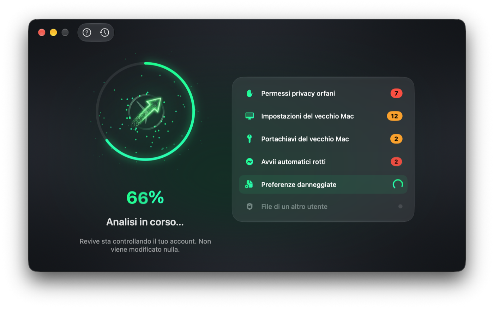 |

| Cosa abbiamo trovato | I dettagli, se ti interessano |
|---|---|
| 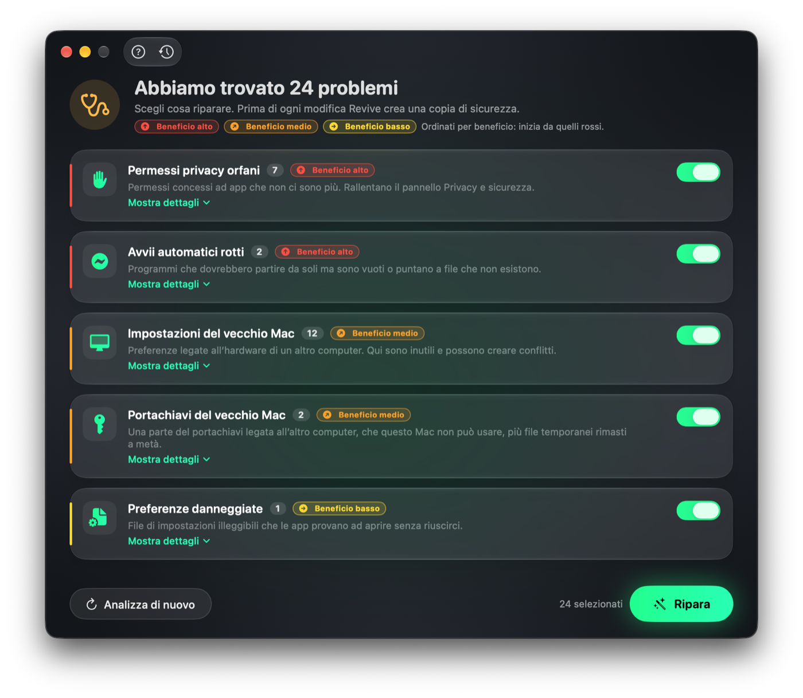 | 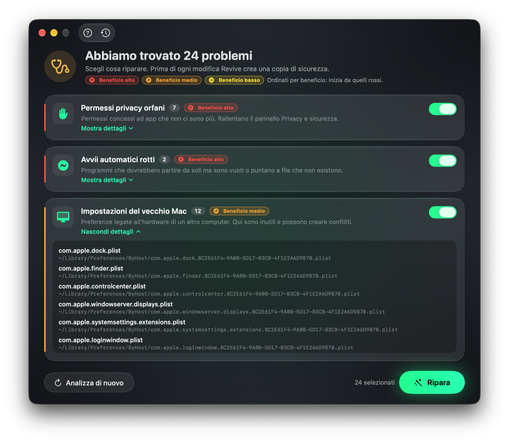 |

| Fatto! | Aggiornamenti automatici |
|---|---|
|  | 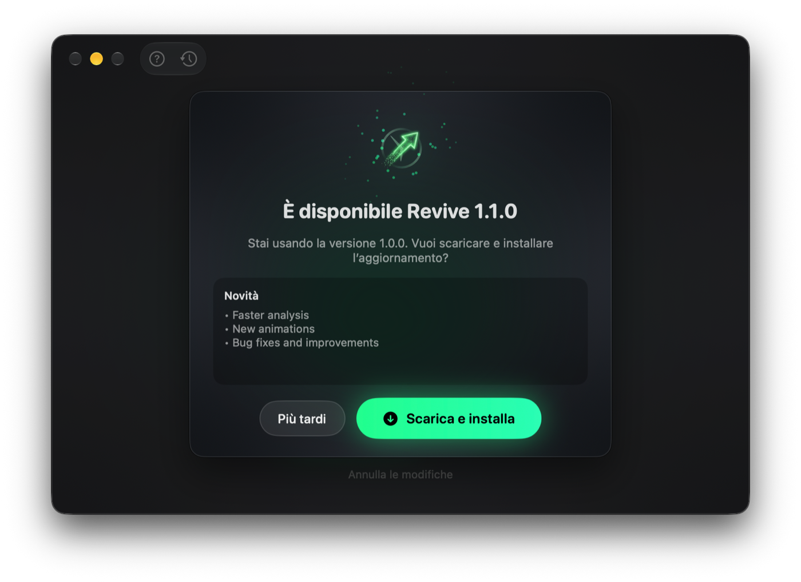 |

| Guida integrata | Impostazioni |
|---|---|
| 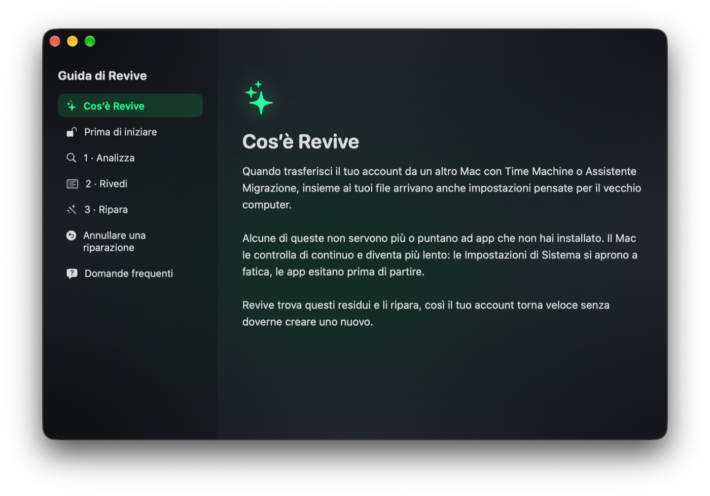 | 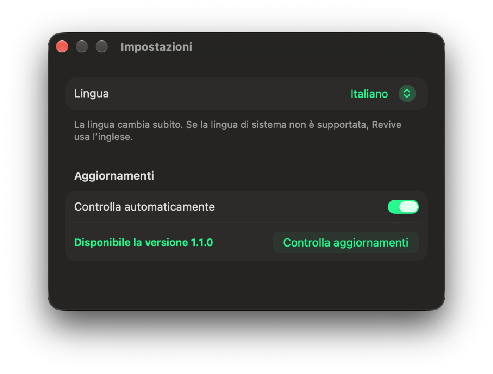 |

## Cosa ripara

| Problema | In parole semplici | Beneficio |
|---|---|---|
| **Permessi privacy orfani** | Permessi (fotocamera, microfono, cartelle…) concessi ad app che sul nuovo Mac non ci sono più. Rallentano il pannello *Privacy e sicurezza*. | 🔴 Alto |
| **Avvii automatici rotti** | Programmi che dovrebbero partire da soli ma sono vuoti o puntano a file inesistenti. | 🔴 Alto |
| **Impostazioni del vecchio Mac** | Preferenze legate all'hardware dell'altro computer: qui sono inutili e possono creare conflitti. | 🟠 Medio |
| **Portachiavi del vecchio Mac** | Una parte del portachiavi legata all'altro computer, che questo Mac non può usare. | 🟠 Medio |
| **File di un altro utente** | File nella tua cartella che appartengono a un altro account, tipico delle migrazioni. | 🟠 Medio |
| **Preferenze danneggiate** | File di impostazioni illeggibili che le app provano ad aprire senza riuscirci. | 🟡 Basso |

## Cosa *non* fa

- **Non cancella i tuoi file.** Documenti, foto, musica e posta non vengono mai toccati.
- **Non è un "pulitore".** Non svuota cache e non promette gigabyte liberati: Revive rende il tuo account **più veloce e stabile**, non libera spazio.
- **Non installa nulla in background** e non resta attivo se non lo usi.

## Installazione

1. Scarica **`Revive-x.y.z.dmg`** dalla pagina delle [release](https://github.com/kikoz85/revive/releases/latest).
2. Apri il file scaricato e **trascina Revive nella cartella Applicazioni**.
3. Apri Revive dalla cartella **Applicazioni** (non dalla finestra del DMG).

### Se macOS blocca l'apertura

Revive non è ancora distribuito tramite l'App Store, quindi al primo avvio macOS può mostrare un avviso del tipo *"Impossibile verificare che Revive sia privo di malware"*. Per aprirlo:

1. Chiudi l'avviso con **Fine**.
2. Apri **Impostazioni di Sistema › Privacy e sicurezza**.
3. Scorri fino alla sezione **Sicurezza**: vedrai *"Revive è stato bloccato…"*. Clicca **Apri comunque** e conferma con la tua password.

Serve solo la prima volta. Gli aggiornamenti successivi, installati da Revive stesso, non richiedono questo passaggio.

## Primo avvio: due permessi

**Accesso completo al disco** — serve a Revive per controllare i permessi della privacy. Revive te lo chiede e ti accompagna:

1. Premi **Apri Impostazioni di Sistema** nella finestra di Revive.
2. In *Privacy e sicurezza › Accesso completo al disco* attiva **Revive** (se non c'è, premi **+** e sceglilo da Applicazioni).
3. Torna su Revive e premi **Fatto, ricontrolla**.

**Notifiche** — al primo controllo degli aggiornamenti macOS ti chiede se Revive può mostrare notifiche: consentile per sapere quando esce una nuova versione.

## Come si usa

1. Premi **Avvia l'analisi** e attendi qualche secondo.
2. Guarda l'elenco: i problemi sono ordinati dal beneficio più alto. Quelli utili sono già selezionati; premi **Mostra dettagli** se vuoi vedere i singoli file.
3. Premi **Ripara**. In alcuni casi macOS ti chiederà la password di amministratore.
4. Alla fine **riavvia il Mac** per rendere effettive tutte le modifiche.

Dopo il riavvio prova ad aprire *Privacy e sicurezza* o le tue app: dovresti notare subito la differenza.

## Annullare una riparazione

Ogni riparazione viene salvata. Premi l'icona con l'**orologio** in alto nella finestra di Revive, scegli la riparazione e premi **Ripristina**: tutto torna esattamente com'era. Poi riavvia il Mac.

## Aggiornamenti

Revive controlla da solo se è disponibile una nuova versione e te lo segnala con una **notifica**. Basta premere **Scarica e installa**: Revive si aggiorna e si riapre da solo.

Puoi controllare anche a mano da **Impostazioni › Controlla aggiornamenti** (o dal menu **Revive › Controlla aggiornamenti…**) e disattivare il controllo automatico.

## Privacy

- Revive lavora **solo sul tuo Mac**: l'analisi e le riparazioni non inviano alcun dato.
- L'unica connessione a Internet serve a **controllare gli aggiornamenti** su questa pagina GitHub e, se lo scegli, a scaricare la nuova versione. Non viene inviata nessuna informazione su di te o sul tuo Mac.

## Domande frequenti

**Revive cancella i miei file?**
No. Sposta solo file di configurazione in una copia di sicurezza, che puoi ripristinare quando vuoi.

**È sicuro?**
Sì. L'analisi non modifica nulla e ogni riparazione si può annullare dalla Cronologia.

**Devo usarlo spesso?**
No: una volta dopo la migrazione di solito basta. Puoi ripetere l'analisi quando vuoi, anche dall'icona nella barra dei menu.

**Funziona sul mio Mac?**
Serve **macOS 14 Sonoma o successivo**. Revive funziona sia sui Mac con chip **Apple** (M1, M2, M3, M4…) sia sui Mac **Intel**.

**In che lingua è?**
Italiano, inglese, francese, tedesco e spagnolo. Revive usa automaticamente la lingua del Mac (inglese se non è tra queste) e puoi cambiarla in **Impostazioni**.

**Revive mi ha trovato "Tutto in ordine" ma il Mac è ancora lento.**
Allora il rallentamento probabilmente non dipende dalla migrazione. Revive fa una cosa sola, in modo mirato.

## Supporto

Hai trovato un problema o hai un suggerimento? Apri una segnalazione nella sezione [Issues](https://github.com/kikoz85/revive/issues) indicando la versione di macOS, il modello di Mac e cosa è successo.

---

# 🇬🇧 English

- [Sound familiar?](#sound-familiar)
- [What Revive is](#what-revive-is)
- [Screenshots](#screenshots)
- [What it repairs](#what-it-repairs)
- [What it does *not* do](#what-it-does-not-do)
- [Installation](#installation)
- [First launch: two permissions](#first-launch-two-permissions)
- [How to use it](#how-to-use-it)
- [Undoing a repair](#undoing-a-repair)
- [Updates](#updates)
- [Privacy](#privacy-1)
- [FAQ](#faq)
- [Support](#support)

## Sound familiar?

You bought a new Mac and moved your account to it with **Time Machine** or **Migration Assistant**. Since then:

- **System Settings › Privacy & Security** takes several seconds to open;
- apps **hesitate before launching**;
- the Mac feels **slower than it should**, even though it's new and powerful;
- yet if you create **a new user**, everything is fast there.

It's not your Mac's fault: your account carries **settings made for the old computer**. macOS keeps checking them for nothing and slows down. Creating a new user and copying everything by hand is slow and painful: **Revive repairs the account you already have**.

## What Revive is

Revive is a simple Mac app, built for people who aren't computer experts too. It works in **three steps**:

1. **Analyze** — a safe, few-second check: nothing is changed.
2. **Review** — Revive shows what's wrong in plain words, with a colored label telling you how much you'll gain: 🔴 high, 🟠 medium, 🟡 low.
3. **Repair** — one click. Before touching anything Revive makes **a backup**, and you can **undo everything** at any time.

## Screenshots

| Welcome | Analyzing |
|---|---|
| 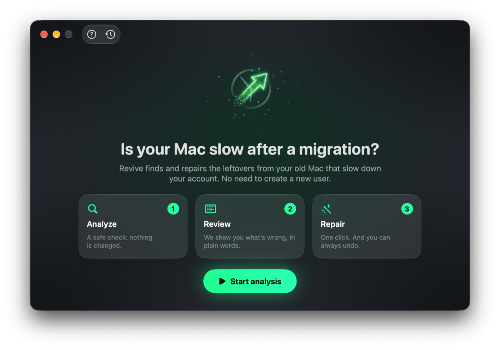 | 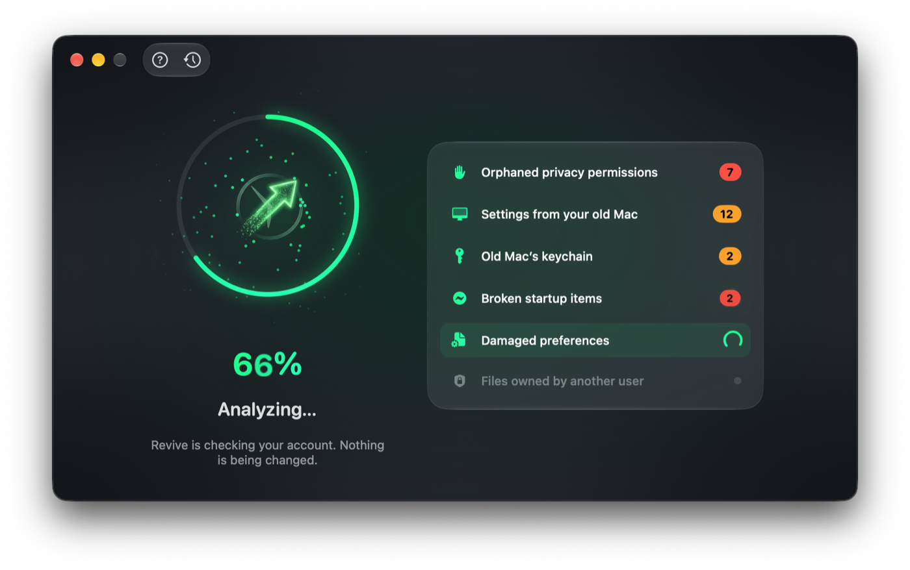 |

| What we found | Details, if you're curious |
|---|---|
| 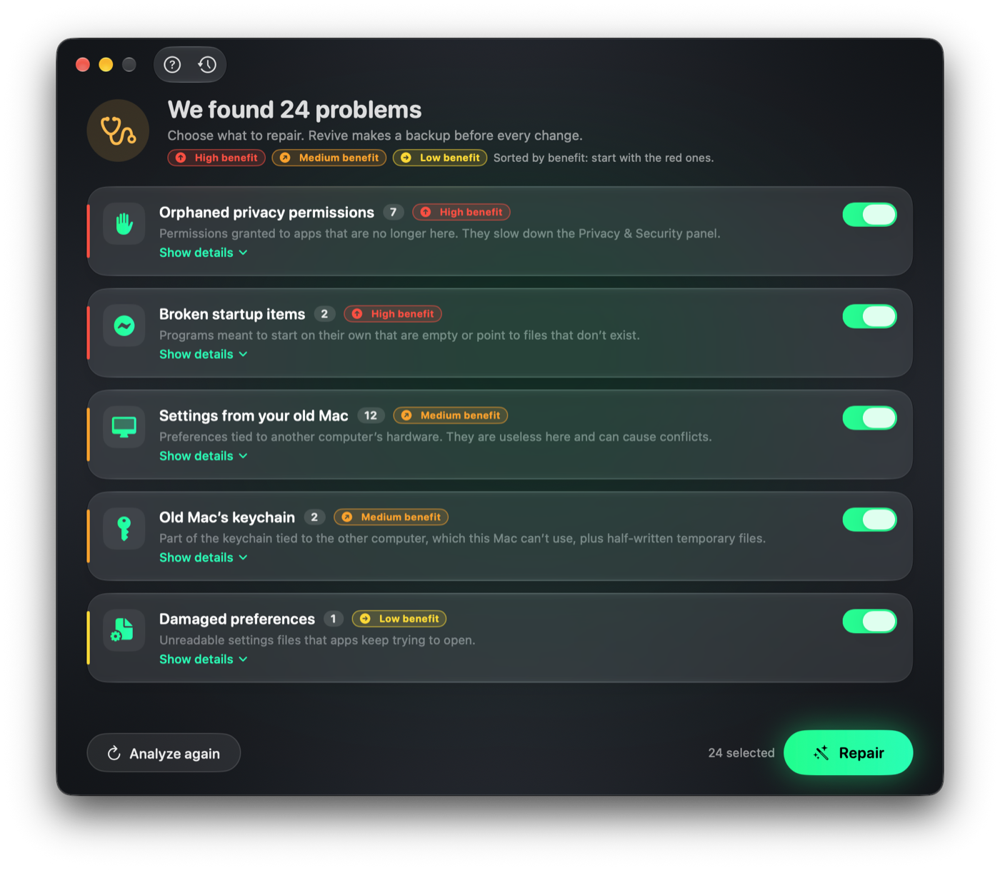 | 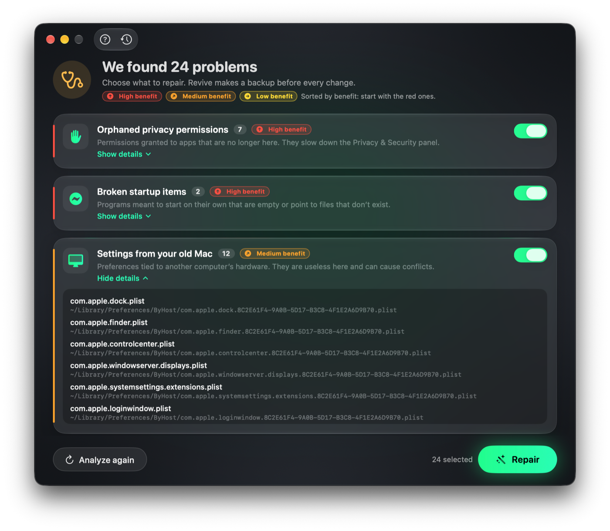 |

| Done! | Automatic updates |
|---|---|
| 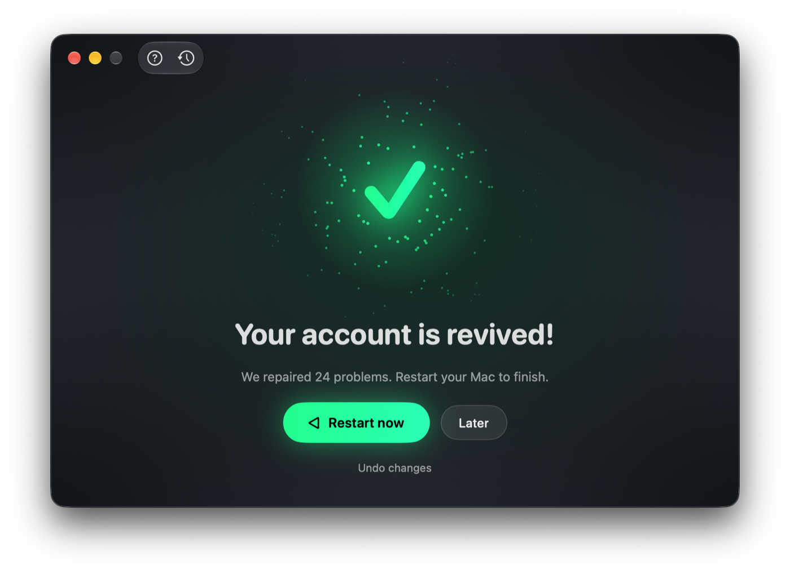 | 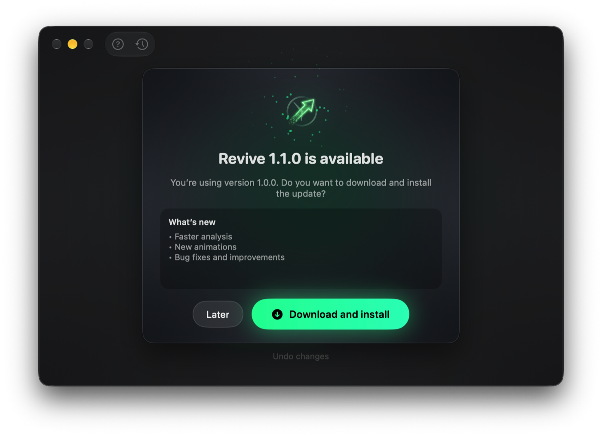 |

| Built-in guide | Settings |
|---|---|
| 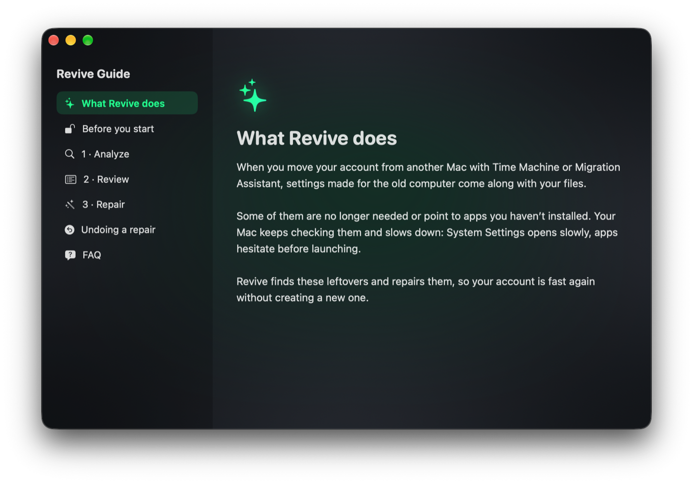 | 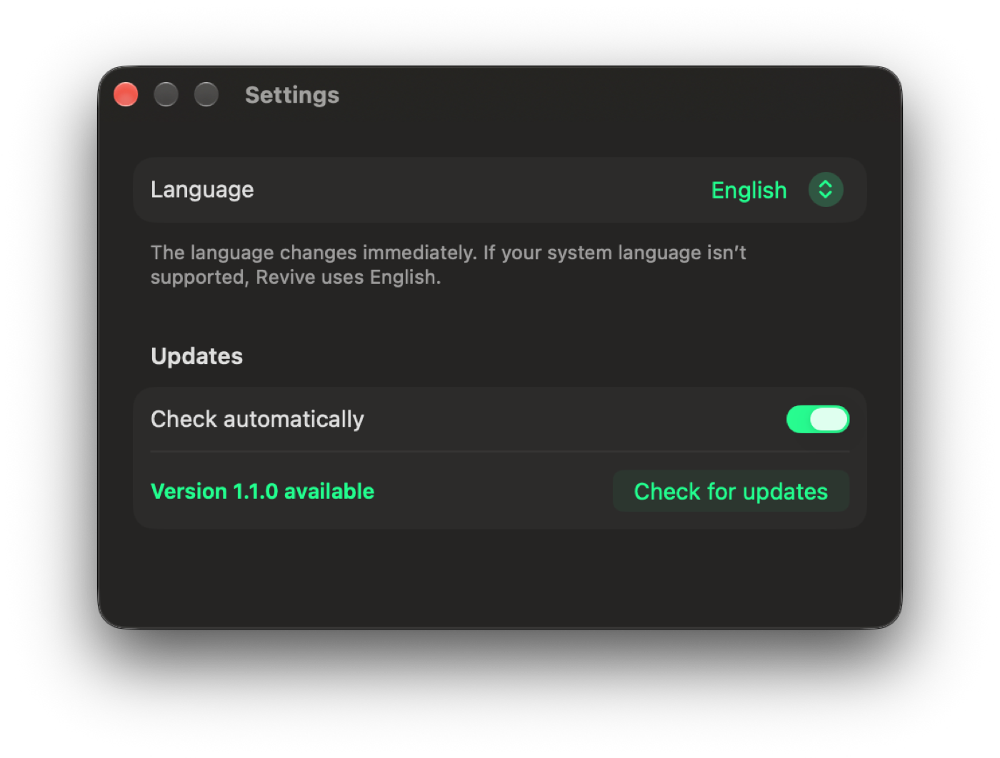 |

## What it repairs

| Problem | In plain words | Benefit |
|---|---|---|
| **Orphaned privacy permissions** | Permissions (camera, microphone, folders…) granted to apps that aren't on the new Mac anymore. They slow down the *Privacy & Security* panel. | 🔴 High |
| **Broken startup items** | Programs meant to start on their own that are empty or point to files that don't exist. | 🔴 High |
| **Settings from your old Mac** | Preferences tied to the other computer's hardware: useless here and a possible source of conflicts. | 🟠 Medium |
| **Old Mac's keychain** | Part of the keychain tied to the other computer, which this Mac can't use. | 🟠 Medium |
| **Files owned by another user** | Files in your folder that belong to another account, typical after a migration. | 🟠 Medium |
| **Damaged preferences** | Unreadable settings files that apps keep trying to open. | 🟡 Low |

## What it does *not* do

- **It doesn't delete your files.** Documents, photos, music and mail are never touched.
- **It isn't a "cleaner".** It doesn't empty caches or promise gigabytes of free space: Revive makes your account **faster and more stable**, it doesn't free up disk space.
- **It doesn't install anything in the background** and doesn't run when you're not using it.

## Installation

1. Download **`Revive-x.y.z.dmg`** from the [releases](https://github.com/kikoz85/revive/releases/latest) page.
2. Open the downloaded file and **drag Revive to the Applications folder**.
3. Open Revive from the **Applications** folder (not from the DMG window).

### If macOS blocks it

Revive isn't distributed through the App Store yet, so on first launch macOS may show a warning like *"Apple could not verify Revive is free of malware"*. To open it:

1. Close the warning with **Done**.
2. Open **System Settings › Privacy & Security**.
3. Scroll to the **Security** section: you'll see *"Revive was blocked…"*. Click **Open Anyway** and confirm with your password.

This is needed only once. Later updates, installed by Revive itself, skip this step.

## First launch: two permissions

**Full Disk Access** — Revive needs it to check privacy permissions. Revive asks for it and walks you through:

1. Click **Open System Settings** in Revive's window.
2. In *Privacy & Security › Full Disk Access* turn on **Revive** (if it's missing, click **+** and pick it from Applications).
3. Go back to Revive and click **Done, check again**.

**Notifications** — on the first update check macOS asks whether Revive may show notifications: allow them to know when a new version is out.

## How to use it

1. Click **Start analysis** and wait a few seconds.
2. Look at the list: problems are sorted by highest benefit. Useful ones are already selected; click **Show details** to see individual files.
3. Click **Repair**. In some cases macOS will ask for your administrator password.
4. When it's done, **restart your Mac** to apply every change.

After restarting, try opening *Privacy & Security* or your apps: you should notice the difference right away.

## Undoing a repair

Every repair is saved. Click the **clock** icon at the top of Revive's window, pick the repair and click **Restore**: everything goes back exactly as it was. Then restart your Mac.

## Updates

Revive checks for new versions on its own and lets you know with a **notification**. Just click **Download and install**: Revive updates and reopens by itself.

You can also check manually from **Settings › Check for updates** (or **Revive › Check for Updates…** in the menu) and turn automatic checks off.

## Privacy

- Revive works **only on your Mac**: analysis and repairs send no data at all.
- The only Internet connection is used to **check for updates** on this GitHub page and, if you choose, to download the new version. No information about you or your Mac is sent.

## FAQ

**Does Revive delete my files?**
No. It only moves configuration files into a backup you can restore whenever you like.

**Is it safe?**
Yes. The analysis changes nothing and every repair can be undone from History.

**Should I use it often?**
No: once after a migration is usually enough. You can analyze again anytime, also from the menu bar icon.

**Will it work on my Mac?**
You need **macOS 14 Sonoma or later**. Revive runs on both **Apple silicon** Macs (M1, M2, M3, M4…) and **Intel** Macs.

**Which languages?**
Italian, English, French, German and Spanish. Revive automatically uses your Mac's language (English if it isn't one of these) and you can change it in **Settings**.

**Revive says "All good" but my Mac is still slow.**
Then the slowdown probably isn't caused by the migration. Revive does one thing, precisely.

## Support

Found a problem or have a suggestion? Open an [issue](https://github.com/kikoz85/revive/issues) with your macOS version, Mac model and what happened.

---

  <b>Revive</b> · © 2026 Enrico Fanucchi · Tutti i diritti riservati · All rights reserved

